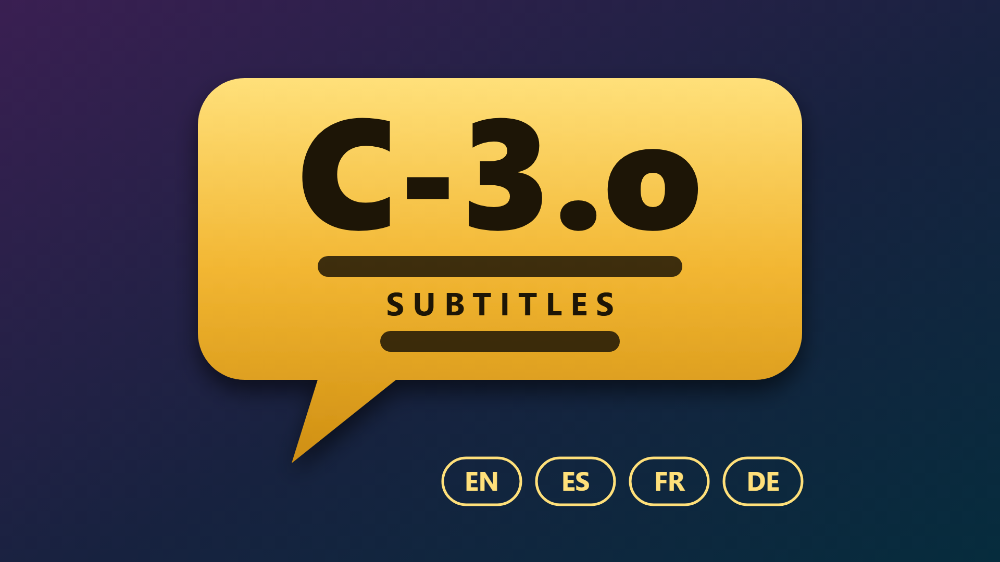

# C-3.o



A Jellyfin server plugin that automatically searches for missing SRT subtitles. Every night it
checks your movies and TV episodes and, for each one that has no SRT subtitle in your preferred
languages (up to five, in your order of preference), finds and downloads one. It uses whatever
subtitle providers are already set up in Jellyfin, so there is no extra account or service to
configure.

Named after a certain protocol droid, fluent in over six million forms of communication.

- Needs **Jellyfin 12.4 or newer** and at least one subtitle provider plugin (for example
  Open Subtitles, with your account entered in it).
- Licence: GPL-3.0. Changes: [CHANGELOG.md](CHANGELOG.md). Credits: [CREDITS.md](CREDITS.md).

## Install

### From the plugin repository (recommended)

1. In Jellyfin, open Dashboard > Plugins > Repositories (the "Manage repositories" button) and
   add a repository with this URL:

   ```
   https://raw.githubusercontent.com/farthing/jellyfin-plugin-c3o/main/manifest.json
   ```

2. Open the plugin catalogue, find **C-3.o** under Subtitles and install it.
3. Restart Jellyfin.
4. Open Dashboard > Plugins > C-3.o, choose at least Language 1 and save. With no language set
   the plugin does nothing.

Updates then arrive through Jellyfin like any other plugin.

### By hand

1. Download `c-3.o_<version>.zip` from the
   [latest release](https://github.com/farthing/jellyfin-plugin-c3o/releases/latest).
2. Unzip it into a new folder named `C-3.o_<version>` inside Jellyfin's plugin folder
   (usually `/var/lib/jellyfin/plugins` on Linux packages, `/config/plugins` in the Docker
   images, `%LOCALAPPDATA%\jellyfin\plugins` on Windows), and make sure the Jellyfin user can
   read it.
3. Restart Jellyfin and set a language as above.

### First run

Tick **Dry run** on the settings page and press **Run now** to see what it would download
without downloading anything. Then untick it, and consider a small "Most downloads per run" for
the first real run.

## What it does

Once a night (03:00 by default) a scheduled task, "Download missing SRT subtitles", does this:

1. Lists the movies and episodes in the selected libraries, newest additions first.
2. For each video and each configured language, decides whether a subtitle is already there
   (see "What counts as already having subtitles").
3. If not, searches every subtitle provider installed on the server, picks the best SRT and
   saves it next to the video as `<video name>.<lang>.srt` (for example `Movie (2016).spa.srt`).
4. Remembers the result, so the next run continues where this one stopped.

It does not talk to any subtitle website itself. It drives the provider plugins the server
already has. Installing another provider plugin gives C-3.o another source with no change here.

## Settings

Everything is configured on the plugin's settings page (Dashboard > Plugins > C-3.o).

| Setting | Default | Meaning |
|---|---|---|
| Language 1 to 5 | none | Wanted languages, most important first. With none set, nothing happens. |
| When downloads are limited | language first | Finish language 1 for the whole library before language 2, or get every language for a title before moving on. |
| Movies / TV episodes | both | What to check. |
| Libraries | all | Which movie and TV libraries to check. |
| A text subtitle track inside the video file counts | on | Off = only an `.srt` beside the video counts, so one is fetched even when the file has that language built in. |
| An SRT with no language in its name counts as language 1 | on | For files like `Movie.srt`. |
| Only exact matches for the video file | off | On = timing is guaranteed, but far fewer titles get a subtitle. |
| Allow hearing-impaired (SDH) | on | Used only when there is nothing else (normal subtitles rank higher). |
| Allow machine or AI translated | off | Used only when there is nothing else. |
| Most downloads per run | 0 (no cap) | A run always stops by itself when the provider's daily limit is used up. |
| Most searches per run | 500 | Spreads the first pass over a large library across several nights. |
| Days before searching again | 30 | For titles where nothing was found. |
| Pause between searches | 1000 ms | Politeness towards the provider. |
| Dry run | off | Checks the first few titles and lists up to 25 subtitles it would download. Downloads nothing. |

The settings page also shows the last run, totals per language, recent downloads, and has
"Run now", "Refresh status" and "Search again for subtitles not found" buttons.

To change when it runs, go to Dashboard > Scheduled Tasks > "Download missing SRT subtitles".

## What counts as already having subtitles

For a given language a video is skipped when any of these is true:

- there is an external `.srt` in that language;
- the video file contains a text subtitle track in that language (setting, on by default);
- for language 1 only: there is an external `.srt` with no language in its name (setting, on by default).

Forced tracks (foreign-dialogue-only) never count, and external subtitles in other formats
(`.ass`, `.sub`, image-based) never count, because the goal is an SRT.

## How a subtitle is chosen

Only SRT results are considered; forced-only results are dropped. The rest are ranked:
exact file (hash) match first, then human-made before machine-translated, then normal before
hearing-impaired, then by download count and rating. If saving the top choice fails, the next
two are tried.

Without "only exact matches", a subtitle made for a different release of the same film can be
picked, and its timing may be off. That is the trade for getting subtitles on most titles.

## The daily download limit (read this)

Subtitle providers limit downloads. Open Subtitles, for example, allows a fixed number per
account per day, depending on the account type (its plugin page shows the number when you save
your login there). A large library with few subtitles can therefore take weeks or longer to
fill. C-3.o is built around that:

- it stops as soon as the provider reports the limit, and resumes the next night;
- newest library additions go first, so new arrivals are not stuck behind the back catalogue;
- nothing is remembered as "not found" when the real cause was an error or the limit.

The server's own "Download missing subtitles" task uses the same account and limit. With
C-3.o in use, consider clearing the subtitle download languages in the library settings so the
two do not compete.

## Why a plugin when Jellyfin has this built in

- Languages, priority order and limits live in one settings page instead of per library.
- It checks for an SRT specifically, not "any subtitle track".
- It tells a provider outage or an exhausted quota apart from "no subtitle exists". The server's
  subtitle manager hides provider errors behind an empty result, so C-3.o calls the providers
  directly for searching (and still saves through the manager, to get the server's own file
  naming and file-watcher handling).
- It remembers attempts and resumes, and shows what it did.

## Troubleshooting

- "No subtitle provider is installed": install a provider such as Open Subtitles from the
  plugin catalogue and enter an account.
- A run that ends with "the download limit ... is used up" is normal. It continues the next night.
- Nothing in the Jellyfin log: C-3.o logs its normal messages at Information level, and many
  servers log warnings or errors only. The status section of the settings page always shows the
  last run; warnings and errors reach the log prefixed `C-3.o`.
- Restarting Jellyfin cancels a run in progress. Nothing is lost; the next run continues.

## Where things live on the server

Inside Jellyfin's plugin folder:

- plugin: `C-3.o_<version>/`
- settings: `configurations/Jellyfin.Plugin.C3o.xml`
- remembered attempts and the last run: `configurations/Jellyfin.Plugin.C3o/state.json`

To remove the plugin completely, uninstall it in the dashboard (or delete its folder), delete
the two `configurations` entries above, and restart Jellyfin. Downloaded subtitles stay.

## Building from source

Needs the .NET 10 SDK.

```
dotnet build Jellyfin.Plugin.C3o -c Release
```

The plugin is the single file `Jellyfin.Plugin.C3o/bin/Release/net10.0/Jellyfin.Plugin.C3o.dll`.

```
C-3o/
  Jellyfin.Plugin.C3o/
    Plugin.cs                      plugin entry, pages, state location
    FetchMissingSubtitlesTask.cs   the scheduled task (all of the logic)
    LibraryScope.cs                which libraries are in scope
    StateStore.cs                  remembered attempts + last run (JSON)
    Api/C3oController.cs           admin-only endpoints for the settings page
    Configuration/                 settings class, settings page (html + js)
  art/                             plugin image: c3o.svg (source), c3o.png, render.ps1
  manifest.json                    the plugin repository that Jellyfin reads
  package.py                       builds the release zip and updates manifest.json
  meta.template.json               plugin details (name, description, target version)
  deploy.sh                        developer helper: build and install over SSH
```

### Installing a development build on your own server

`deploy.sh` builds the plugin and copies it to a Jellyfin server over SSH (directly, or into a
Proxmox or Docker container). Copy `deploy.env.example` to `.local/deploy.env`, set your host,
then from a bash shell (Git Bash on Windows):

```
./deploy.sh                    # build, copy, verify the checksum
./deploy.sh --restart          # same, then restart Jellyfin
./deploy.sh --restart --force  # restart even if someone is watching or a run is in progress
```

`--restart` first checks that nobody is watching (a media file held open) and that no C-3.o run
is in progress, and refuses if either is true.

### Jellyfin version

Built against Jellyfin 12.4 (`Jellyfin.Controller` 12.4.0, .NET 10), and `targetAbi` is
12.4.0.0. For a newer Jellyfin, raise the two package versions in the `.csproj` and `targetAbi`
in `meta.template.json`, then rebuild. The plugin relies on these server pieces:
`ISubtitleProvider`, `ISubtitleManager.DownloadSubtitles` / `GetSupportedProviders`,
`ILibraryManager.GetItemList`, `IScheduledTask`.

The description shown in Jellyfin comes from `Description` in `Plugin.cs` for hand-installed
copies and from `manifest.json` for repository installs; `package.py` fills the manifest from
`meta.template.json`, so keep those two texts the same.

### Releasing

1. Raise `<Version>` (and the two versions beside it) in the `.csproj`.
2. Add a `## <version>` section to `CHANGELOG.md`.
3. Run `python package.py`. It builds `dist/c-3.o_<version>.zip` and puts the new version, with
   the zip's checksum, at the top of `manifest.json`.
4. Commit, tag `v<version>`, push, and create a GitHub release for that tag with the zip
   attached (`package.py` prints the commands). The zip must be the one `package.py` just
   built, because the manifest holds its checksum.

Jellyfin servers that use the repository see the new version once `manifest.json` is on `main`.

## Disclaimer

C-3.o is a fan-made, non-commercial project. It is not affiliated with or endorsed by the
Jellyfin project, Lucasfilm or Disney. Subtitles come from the providers you have set up and
are subject to their terms.
